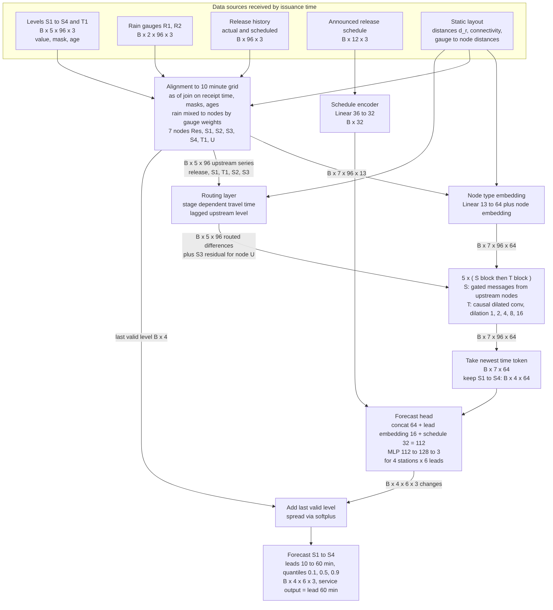

# Question 1. River Forecasting Proposal

**Q.** Design your forecasting system. Use these six report headings in this order. Answer directly and concisely. Choose any defensible architecture; there is no word or page limit.

**Answer.** The proposed system is a small graph network that follows the river. Each station forecast starts from the last measured level and adds a learned change. That change comes from upstream levels delayed by their travel time, from rain that has already fallen and from the announced reservoir releases. The six sections below follow the required headings in order.

## 1. Architecture diagram

**Q.** Draw the architecture first: show each data source, the main processing blocks, source combination, and forecasts for S1–S4. Label main tensor dimensions and any alignment, projection, or reshaping needed to combine inputs.

**Answer.** Figure Q1 shows the full system from the raw data sources to the forecasts at S1 to S4.

Figure Q1. The diagram shows the five data sources, the alignment block, the node embedding, the routing layer, five pairs of spatial and temporal blocks, the schedule encoder, the forecast head and the output. Tensor sizes label the arrows and B is the batch axis, which equals 1 in operation.

The diagram is read from top to bottom in five steps.

1. **Alignment.** Every source is put on one 10 minute grid. Each value gets a mask that says whether a real reading exists and an age that says how old the last real reading is.
2. **Source combination.** The aligned data are arranged on seven graph nodes. These are the reservoir, S1, S2, S3, S4, the tributary station T1 and a latent node U for the unmonitored tributary. Rain from R1 and R2 is spread over the nodes with learned weights and the release history is attached to the reservoir node.
3. **Projection.** A linear map turns the 13 features of each node at each time into 64 numbers.
4. **Processing.** A routing layer delays each upstream series by a travel time that depends on the water level. Five pairs of blocks then mix information along the river and along time.
5. **Reshaping and output.** The newest time step of S1 to S4 is taken out, combined with the encoded release schedule and turned into a 4 by 6 by 3 output. This holds four stations, six leads and three quantiles.

The main design choices come from the lectures. Lecture 6 lists three ways to combine space and time, which are joint, factorized and recurrent. It also names message passing on the graph as the spatial operator when the data live on a graph, such as road or power networks. This design uses factorized blocks on the river graph because the stations are unevenly spaced and do not form a regular grid. The direct multi step head follows lecture 5.1, which states that direct forecasting avoids the error accumulation of autoregressive decoding. The last level baseline is the naive forecast of lecture 3 and the mix of a physical routing rule with learned blocks follows the hybrid of model driven and data driven methods that lecture 3 describes.

## 2. Assumptions

**Q.** List each assumption separately as A1, A2, etc. Explain why each is reasonable and how it affects your design. Distinguish assumptions from supplied facts. Cover unspecified data conditions and the river dynamics your model assumes.

**Answer.** Table Q1.1 lists the supplied facts first so that they stay separate from the assumptions. Table Q1.2 then lists every assumption that the brief leaves open.

| ID | Supplied fact |
|---|---|
| F1 | Levels at S1 to S4 and T1 are recorded every ten minutes. |
| F2 | Rain at R1 and R2 comes with timestamps and gauge locations. |
| F3 | Recorded releases and announced schedules carry announcement and effective times. |
| F4 | Station locations, river connectivity and distances along the river are known. |
| F5 | A monitored tributary joins between S1 and S2 and an unmonitored one joins between S2 and S3. |
| F6 | Stations are unevenly spaced and travel times change with river conditions. |
| F7 | Travel times and unmonitored inflow are not supplied. Future rain and future levels are not available at issuance. |

Table Q1.1. This table lists the supplied facts from the brief.

| ID | Assumption | Why it is reasonable | Effect on the design |
|---|---|---|---|
| A1 | The record covers at least five years and includes at least ten events above the alert level. | A national authority normally keeps long gauge records and floods are the reason for the service. | This record supports a model of about 0.42 million parameters. A shorter record would move the service to the ridge baseline of Section 4. |
| A2 | Each level series uses one fixed datum and is recorded in metres. | Gauge datums rarely change without a logged survey. | Each station is normalised with a median and an interquartile range from the training period. |
| A3 | Rain gauges report the amount that fell in each interval, stamped at the end of the interval. | Tipping bucket gauges report this way. | Rain enters as a sum per 10 minute bin and is never interpolated. |
| A4 | All clocks use one time zone and 95 percent of readings arrive within 2 minutes, with 99 percent within 15 minutes. | Telemetry from remote gauges commonly shows a short delay with a long tail. | Issuance waits a 2 minute grace period and training adds random delays drawn from this distribution. |
| A5 | About 5 percent of readings are missing and outages can last several hours. | Remote sensors lose power and links. | Every series carries a mask and an age and training removes values at random. |
| A6 | Level noise is about 2 cm and rare spikes occur. | Radar and pressure gauges have noise of a few centimetres. | A range and rate of change check removes spikes before they reach the model. |
| A7 | Water flows one way along the main stem and backwater from below S4 has no effect within one hour. | The brief shows a single main stem with arrows for flow. | Messages travel only from upstream to downstream and S4 has no downstream input. |
| A8 | The travel time between neighbouring nodes lies between 10 minutes and 4 hours and the reservoir to S4 total stays under 10 hours. T1 is close enough to its junction that its travel time also fits this range. | The stations are kilometres apart and the brief says travel times vary. | The temporal reach of the model is 62 steps or 10.3 hours and the history window is 96 steps. |
| A9 | The flood wave moves faster when the water is higher. | Open channel theory gives a wave speed that grows with depth for flow inside the banks. | The routing layer uses a speed that rises with the normalised upstream level. |
| A10 | Gauge R1 mostly represents the catchment above S2 and gauge R2 the catchment above S3 and S4. | Gauge locations are supplied but catchment limits are not. | A learned weight links each gauge to each node and starts from inverse distance. |
| A11 | Rain from the last 6 hours still affects levels in the next hour. | Catchments usually respond to rain after 30 minutes to several hours. | The history window keeps 16 hours of rain, which is longer than this memory, so slow responses are still seen. |
| A12 | The unmonitored tributary is driven mainly by rain at R2 and carries flows of the same order as T1. | It lies in the same area as the S2 to S3 reach. | It is a latent node fed by rain at R2 and by the unexplained rise at S3. |
| A13 | Release schedules usually cover at least 2 hours ahead and releases are recorded in cubic metres per second. | Reservoir operators publish short term plans. | The schedule encoder reads 12 future steps and a missing schedule is marked by a flag. |
| A14 | The channel shape stays stable between retraining dates. | Large changes need a major flood and the model is retrained after each one. | One model serves all seasons and is retrained once a year and after major floods. |
| A15 | Levels above the alert level occur in under 1 percent of timestamps. | Floods are rare events. | The loss gives alert level targets four times the weight of normal targets. |

Table Q1.2. This table lists each assumption with its justification and its effect on the design. Section 6 returns to the risks that these assumptions carry.

## 3. Forecasting task and data specification

**Q.** Define issuance time, your history window, the one-hour horizon, and outputs for S1–S4. In one table, list each input and output, its dimensions, axis meanings (including any batch axis), and timestamps or time coverage. Explain alignment across locations and sampling times, and identify information available at issuance.

**Answer.** The time grid has 10 minute steps in one time zone and each grid time is written as τ.

- **Issuance time.** A forecast is issued at τ plus 2 minutes. It uses only records whose receipt time is at or before that moment.
- **History window.** The window holds L equal to 96 steps, so it covers 16 hours from τ minus 950 minutes to τ.
- **Horizon.** The horizon holds H equal to 6 steps, so the forecast covers 10, 20, 30, 40, 50 and 60 minutes after τ.
- **Outputs.** The service output is the lead 6 value, which is one hour ahead, at each of S1 to S4. The five shorter leads help training and give the operator a trajectory. Each output holds three quantiles at 0.1, 0.5 and 0.9.
- **Schedule.** The announced release schedule covers F equal to 12 future steps.

Table Q1.3 lists every input and output in one place.

| Name | Tensor | Axes in order | Time coverage | Available at issuance |
|---|---|---|---|---|
| Levels | B × 5 × 96 × 3 | batch, station S1 S2 S3 S4 T1, time from oldest to newest, channel value mask age | τ minus 950 min to τ | Yes, if received by τ plus 2 min |
| Rain | B × 2 × 96 × 3 | batch, gauge R1 R2, time, channel amount mask age | τ minus 950 min to τ | Yes, if received by τ plus 2 min |
| Release history | B × 96 × 3 | batch, time, channel actual release, scheduled release, mask | τ minus 950 min to τ | Yes, if received by τ plus 2 min |
| Announced schedule | B × 12 × 3 | batch, future step, channel scheduled release, time since announcement, announced flag | τ plus 10 min to τ plus 120 min | Only entries announced by τ plus 2 min |
| Reach table | 6 × 2 | reach, channel distance along the river and reach type | Fixed | Yes |
| Gauge distances | 2 × 7 | gauge R1 R2, node | Fixed | Yes |
| Forecast output | B × 4 × 6 × 3 | batch, station S1 to S4, lead 10 to 60 min, quantile 0.1 0.5 0.9 | τ plus 10 min to τ plus 60 min | No, this is the prediction |
| Training target | B × 4 × 6 | batch, station S1 to S4, lead | τ plus 10 min to τ plus 60 min | No, it is used only for training and scoring |

Table Q1.3. This table lists every input and output with its dimensions, axis meanings and time coverage. The batch axis B counts issuance times in a training batch and equals 1 in operation.

**Alignment across sampling times.** Every source is mapped to the same 10 minute grid, which is the resampling to uniform steps that lecture 3 recommends for irregular series. A level takes the latest reading at or before each grid time. Rain and releases take the sum or mean over the bin that ends at the grid time. Each value then gets a mask equal to 1 when a real reading exists and an age that counts the steps since the last real reading.

**Alignment across locations.** The data are placed on seven graph nodes, which are the reservoir, S1, S2, S3, S4, T1 and the latent node U. The six directed reaches are reservoir to S1, S1 to S2, T1 to S2, S2 to S3, U to S3 and S3 to S4. Rain is spread over the nodes with a learned 7 by 2 weight matrix, so no gauge needs to be tied to one station. Each node then holds 13 features made of 3 level, 3 rain, 3 release and 4 node type features. Slots that do not apply to a node are filled with zero and a mask of 0.

**Information available at issuance.** The model may use every level, rain and release record received by τ plus 2 minutes and every schedule entry announced by that time. Future rain and future levels are never used. Future releases enter only through the announced schedule. Training windows apply the same receipt time filter, so a late value is missing in training exactly when it would be missing in service.

## 4. Model computations and design justification

**Q.** Define notation and give core equations for the main blocks, forecast mapping, and training objective. Justify major choices and explain how upstream conditions, tributaries, rainfall, and reservoir releases influence each forecast. Distinguish physical assumptions from learned mappings. Refer to your diagram and assumptions; exhaustive intermediate tensor dimensions are not required.

**Answer.** The equations follow the blocks of Figure Q1 from top to bottom and use the notation in Table Q1.4.

| Symbol | Meaning |
|---|---|
| N, T, d | 7 nodes, 96 history steps, 64 channels |
| H, Q, F | 6 leads, 3 quantiles, 12 schedule steps |
| $x_{n,t}$ | the 13 input features of node n at step t |
| $h_{n,t}$ | the 64 channel state of node n at step t |
| $\kappa(n)$ | the type of node n, which is reservoir, station, tributary or latent |
| $r=(m\to n)$ | a directed reach from node m to node n with distance $d_r$ |
| $\hat h_{m,t}$ | the normalised level of node m, or the normalised release for the reservoir |
| $\Delta$ | the 10 minute step of 600 seconds |

Table Q1.4. This table gives the notation used in the equations below.

**Embedding.** This step turns the 13 raw features of each node and time into 64 numbers. Each node type has its own linear map and each node has its own learned offset $p_n$.

$$h^{(0)}_{n,t}=W_{\kappa(n)}\,x_{n,t}+b_{\kappa(n)}+p_n$$

**Routing layer, the physical prior.** This step estimates when water seen upstream will reach the next node. Following A9, the wave speed $c$ on reach r rises with the upstream level. The lag $\lambda$ in steps is the distance divided by the speed.

$$c_{r,t}=\mathrm{softplus}(a_r)\,\exp\big(\mathrm{softplus}(\beta_r)\,\hat h_{m,t}\big),\qquad \lambda_{r,t}=\frac{d_r}{c_{r,t}\,\Delta}$$

The routed value is the upstream series read $\lambda$ steps back, with linear interpolation between the two nearest steps.

$$\tilde x_{r,t}=(1-f)\,\hat h_{m,t-\lfloor\lambda\rfloor}+f\,\hat h_{m,t-\lfloor\lambda\rfloor-1},\qquad f=\lambda-\lfloor\lambda\rfloor$$

The lag is clipped to the window. The routed difference $\rho_{r,t}=\tilde x_{r,t}-\hat h_{n,t}$ tells the model how far the downstream level is expected to move. The interpolation is differentiable, so the two numbers $a_r$ and $\beta_r$ of each reach are learned from data. The shape of the speed law is the physical assumption and those two numbers are learned. Five reaches are routed. The U to S3 reach has no measured level, so its routed difference is set to zero.

**Spatial block S.** This step lets each node receive information from its upstream neighbours at the same time step. Each incoming reach gets a gate between 0 and 1. A sigmoid gate is used instead of a softmax so that flows from two branches add up at a junction instead of being averaged, which matches the additive junction of A7.

$$g_{r,t}=\sigma\big(v^{\top}\tanh(W_a[\,h_{m,t};\,h_{n,t};\,\psi(d_r);\,\rho_{r,t}])\big)$$

$$h'_{n,t}=\mathrm{LN}\Big(h_{n,t}+\mathrm{GELU}\big(W_s h_{n,t}+\textstyle\sum_{r=(m\to n)}g_{r,t}\,W_{\kappa(m)}h_{m,t}\big)\Big)$$

Here $\psi(d_r)$ is a learned encoding of the reach distance, LN is layer normalisation and the first term inside LN is the residual path.

**Temporal block T.** This step lets each node look back over its own past. It is a causal convolution with kernel size 3 and dilation $\delta_\ell\in\{1,2,4,8,16\}$ in pair $\ell$. Causal means that step t never sees a later step.

$$h''_{n,t}=\mathrm{LN}\Big(h'_{n,t}+\mathrm{GELU}\big(\textstyle\sum_{j=0}^{2}W^{(j)}_{\kappa(n)}\,h'_{n,t-j\delta_\ell}\big)\Big)$$

**Reach of the stack.** Five S then T pairs give a spatial reach of five hops, which covers the four hop path from the reservoir to S4. The temporal reach is $2\times(1+2+4+8+16)=62$ steps or 10.3 hours, which covers the longest travel time assumed in A8. The companion notebook shows that a stack of local blocks cannot use an observation outside its reach, so the reach here is set by construction and not left to chance.

**Unmonitored tributary.** The latent node U has no level reading. Following A12, its input holds the rain mix for R2 and the rise at S3 that the routed S2 level does not explain.

$$\varepsilon_t=\hat h_{S3,t}-\tilde x_{S2\to S3,t}$$

This residual is the only measured trace of the missing inflow, so it is passed to U directly. U then sends a message to S3 like any other upstream node.

**Forecast mapping.** The schedule encoder flattens the 12 by 3 schedule and maps it to a vector $u$ of 32 numbers. For station n and lead h, the head reads the newest state $z_n=h^{(5)}_{n,T}$ and a learned lead embedding $e_h$ of 16 numbers. A two layer MLP with 128 hidden units gives three outputs.

$$o_{n,h}=\mathrm{MLP}([z_n;\,e_h;\,u])\in\mathbb R^3$$

$$\hat y_{n,h,0.5}=\ell_n+o^{(1)}_{n,h},\qquad \hat y_{n,h,0.1}=\hat y_{n,h,0.5}-\mathrm{softplus}(o^{(2)}_{n,h}),\qquad \hat y_{n,h,0.9}=\hat y_{n,h,0.5}+\mathrm{softplus}(o^{(3)}_{n,h})$$

The term $\ell_n$ is the last valid normalised level of station n. The model therefore predicts a change from that level. This follows the NLinear idea of lecture 5.1, which subtracts the last value of the window and adds it back, so shifts in level between seasons drop out. The softplus is always positive, so the three quantiles can never cross.

**Training objective.** The loss is the pinball loss, which trains each output to be the requested quantile. A mask $m$ equals 1 where the true level exists, so missing targets add nothing.

$$\mathcal L=\frac{1}{\sum m}\sum_{b,n,h}m_{b,n,h}\,w_{b,n,h}\sum_{q\in Q}\max\big(q\,(y_{b,n,h}-\hat y_{b,n,h,q}),\,(q-1)(y_{b,n,h}-\hat y_{b,n,h,q})\big)$$

$$w_{b,n,h}=\omega_h\big(1+\gamma\,\mathbf 1[y_{b,n,h}>y^{\mathrm{alert}}_n]\big),\qquad \omega_6=2,\quad \omega_{h<6}=1,\quad \gamma=4$$

Lead 6 gets double weight because it is the service output. Alert level targets get extra weight because the service exists for flood preparedness, as stated in A15.

**How each driver reaches each forecast.** Table Q1.5 traces each driver to each station.

| Forecast | Upstream conditions | Tributaries | Rainfall | Reservoir releases |
|---|---|---|---|---|
| S1 | S1 uses its own history. | No tributary joins above S1. | The R1 share of rain reaches S1 through the gauge weights. | Past releases are routed from the reservoir and the schedule enters the head directly. |
| S2 | The S1 level arrives with its routed lag. | T1 arrives through the monitored junction. | Rain from R1 and R2 reaches S2 through the gauge weights. | Releases arrive through S1 and through the schedule vector. |
| S3 | The S2 level arrives with its routed lag. | Node U carries the R2 rain and the unexplained rise at S3. | The R2 share of rain reaches S3 through the gauge weights and through U. | Releases arrive through S2 and through the schedule vector. |
| S4 | The S3 level arrives with its routed lag and everything further upstream arrives within five hops. | Both tributaries arrive through S3. | The R2 share of rain reaches S4 through the gauge weights. | Releases arrive through S3 and through the schedule vector. |

Table Q1.5. This table states the path by which each driver reaches each station forecast.

**Justification of the major choices.** Factorized blocks were chosen over joint attention for two reasons. Lecture 6 points out that the main benefit of factorization is lower compute. Counted from the layer sizes, the whole model needs about 93 million multiply adds per forecast, while the token mixing of five joint attention blocks over 672 tokens alone needs about 289 million. Both costs are small for a 10 minute cycle, so cost is not the deciding point. The deciding point is the built in sense of distance. Attention has no built in notion of which stations are neighbours, so it would likely need more flood events than a few years of records provide. A ConvLSTM was not chosen because Shi et al. 2015 apply it to radar maps on a regular grid with convolutions over neighbouring cells, while this river has seven nodes on an uneven graph. A pure physical simulator was set aside because the travel times and the unmonitored inflow are not supplied. A pure neural network without routing was set aside because the lag depends on the water level and that dependence is simple to state physically.

**Physical assumptions against learned mappings.** The physical assumptions are the one way flow direction of A7, the shape of the speed law of A9, the use of the last level as the starting point and the additive junction. The learned mappings are the two speed numbers per reach, the gates, the rain weights, the rain response, the release response and the width of the quantile band. A persistence forecast and a ridge regression on lagged upstream levels, rain and releases are trained first, as lecture 3 recommends for any new design. The neural system is accepted only if it beats both on the validation pinball loss at lead 6.

**Trade off.** The routing prior and the graph structure make the model small and easy to explain to the committee. The price is that a wrong speed law or a wrong graph would bias the forecasts, so the ridge baseline is kept running as a check.

## 5. Operation and exceptional conditions

**Q.** Explain separately how you handle (i) missing observations, (ii) delayed observations, (iii) announced future releases, and (iv) differences between scheduled and actual releases. Justify feasibility of running every ten minutes; no implementation or benchmark is required.

**Answer.** Each condition is handled separately below, followed by the feasibility argument.

**(i) Missing observations.** A missing value sets its mask to 0 and its age to the number of steps since the last real reading. The value is filled with the last real reading for up to 30 minutes and with the station median beyond that. Training removes 5 percent of values at random and removes whole stations for blocks of up to 6 hours, so the model learns to rely on neighbours. When a station has been missing for more than 6 hours, its forecast switches to the ridge baseline and is marked as degraded. The quantile band is likely wider in this state because training exposes the head to such gaps, although this is not tested. A missing target is excluded from the loss through the mask.

**(ii) Delayed observations.** The forecast is issued 2 minutes after each grid time with whatever has arrived. A record that arrives later is stored with its true measurement time and enters the next cycle normally. If a late record would move a lead 6 median by more than half the width of its 0.1 to 0.9 band, a corrected forecast is published. Training applies the same receipt time filter and random delays from A4, so the model sees the same lateness in training and in service.

**(iii) Announced future releases.** A schedule entry is used only if its announcement time is at or before the issuance time. For each of the next 12 steps, the latest announced value whose effective time is at or before that step is used and it holds until the next entry. The encoder also receives the time since announcement and an announced flag, so an old announcement can be trusted less. When no schedule exists the flag is 0 and the model relies on the last actual release.

**(iv) Scheduled against actual releases.** The release history holds both the actual and the scheduled value for past steps, so the model sees the gap between them. This gap is the signal for gate delays and unannounced changes. When the last actual release differs from the schedule by more than 10 percent, the forecast carries a flag for the operator. The model is likely to rely more on the actual release and on the S1 response in that case, because training includes such gaps, although this is not tested. Past gaps are also logged to measure how reliable each operator's schedules are.

**Feasibility of a 10 minute cycle.** Counted from the layer sizes, with an 8 number distance encoding and separate weights per node type, the model has about 0.42 million parameters, which is 1.7 MB in 32 bit numbers. One forecast needs about 93 million multiply adds, which is about 0.19 billion floating point operations. A plain CPU at 1 billion operations per second would finish in about 0.2 seconds, while the cycle allows 600 seconds. Data collection and quality checks fit inside the 2 minute grace period. Retraining runs offline once a year and after each major flood. These figures are counts from the layer sizes and were not benchmarked.

## 6. Uncertainty, limitations, and additional information

**Q.** List uncertainties and limitations, including the unmonitored tributary and changing travel times. Explain each one’s forecast impact and your response, or what remains unresolved. List each additional information request, how it would help, and whether the system remains usable without it.

**Answer.** Table Q1.6 lists the uncertainties and limitations. Table Q1.7 lists the requests for more information.

| ID | Uncertainty or limitation | Forecast impact | Response | What remains unresolved |
|---|---|---|---|---|
| U1 | The unmonitored tributary adds unknown inflow between S2 and S3. | S3 and S4 may be under or over predicted during storms. | The latent node U uses R2 rain and the unexplained rise at S3 and the quantile band widens. | Inflow cannot be told apart from rating or sensor error at S3. |
| U2 | Travel times change with river conditions. | The timing of a rise at the next station may be wrong. | The routing layer uses a speed that rises with level and the gates are learned. | Overbank flow slows the wave in ways the speed law ignores and training holds few such events. |
| U3 | Future rain is unknown. | A rise caused by rain after τ is missed at first. | Rain that has already fallen is used and the band widens after recent rain. | A rain forecast for the next hour would reduce this and is requested as R4. |
| U4 | Only two rain gauges cover the catchment. | Local storms between the gauges can be missed. | Learned gauge weights and wide bands are used. | No spatial rain field exists. |
| U5 | Release schedules can change or fail. | The inflow at S1 may be wrong. | The gap between actual and scheduled releases is tracked and flagged. | Emergency releases without announcement cannot be predicted. |
| U6 | The record holds few flood events. | Accuracy at peaks may be poor. | The loss gives extra weight to alert levels and the head outputs quantiles. | Floods larger than any in the record are not covered. |
| U7 | Sensors can fail or drift. | Inputs may be biased. | Range and rate checks, per station normalisation and a drift alarm are used. | Slow drift can look like a real change. |
| U8 | Backwater and channel change can occur. | S4 may show errors after major floods. | The model is retrained after floods. | These effects are not modelled within one hour. |

Table Q1.6. This table lists each uncertainty or limitation with its impact, the response and what remains open.

| ID | Additional information request | How it would help | Is the system usable without it |
|---|---|---|---|
| R1 | Rating curves that convert level to flow at each station | They allow a flow balance at the junctions. | Yes, because levels are used directly. |
| R2 | Channel slope and cross sections for each reach | They give starting values for the wave speed. | Yes, because the speed is learned from data. |
| R3 | A gauge or flow estimate on the unmonitored tributary | It removes the main source of error at S3 and S4. | Yes, because node U stands in for it. |
| R4 | Radar or weather model rain forecasts for the next hours | They give earlier warning of rises. | Yes, with the limit on rain after τ stated in U3. |
| R5 | Receipt times and quality flags for past data | They make the delay training exact. | Yes, with the assumed delays of A4. |
| R6 | The alert level of each station | It sets the loss weights exactly. | Yes, with a percentile rule in its place. |
| R7 | The rules for emergency releases | They explain unannounced changes. | Yes, with the tracked gap between actual and scheduled releases. |
| R8 | A longer record and a log of past floods | They improve accuracy at peaks. | Yes, with the ridge baseline as fallback under A1. |

Table Q1.7. This table lists each request, its benefit and whether the system still works without it.

**Treatment of physics and uncertainty.** No separate simulator or probabilistic model is built. Physical relations enter through the routing layer, the one way message structure and the additive junction. Uncertainty enters through the three quantile outputs and through the degraded state flags.

**Trade off.** A small hybrid model keeps the system explainable and cheap to run. The price is that unseen extremes and the unmonitored tributary remain real limits, which the quantile band and the flags report to the operator instead of hiding.
